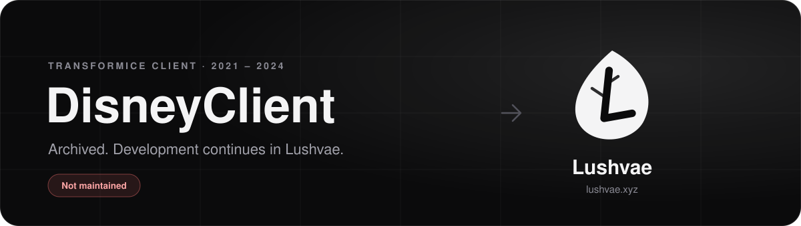
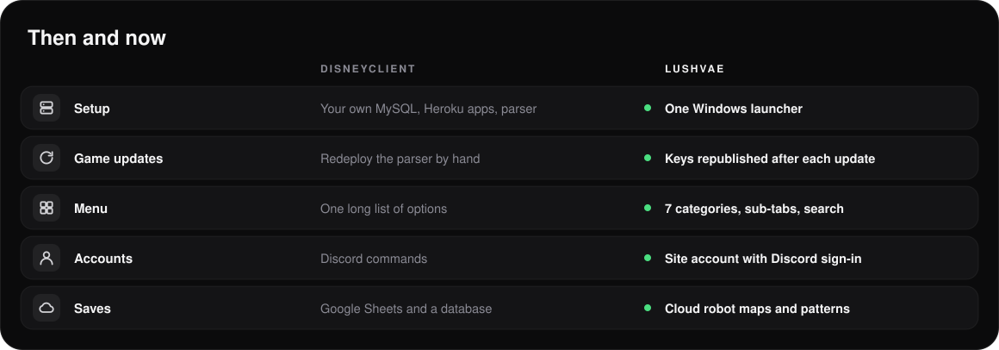
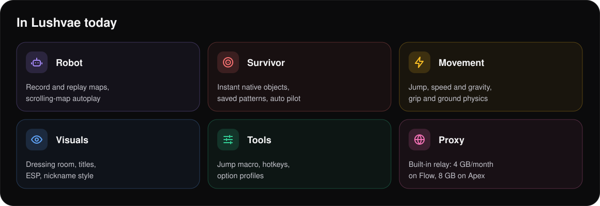

  

  <a href="https://lushvae.xyz"><b>🌿 lushvae.xyz</b></a> ·
  <a href="#then-and-now"><b>🔁 Then and now</b></a> ·
  <a href="#in-lushvae-today"><b>✨ Lushvae today</b></a> ·
  <a href="#credits"><b>🤝 Credits</b></a> ·
  <a href="#legacy-setup"><b>🗄️ Legacy setup</b></a>

> [!IMPORTANT]
> DisneyClient was a self-hosted Transformice menu, maintained from 2021 to 2024. It is no longer updated and gets no support.
> Its successor is **[Lushvae](https://lushvae.xyz)**, made by the same team.

## Then and now

Running DisneyClient meant setting up a MySQL database, two Heroku apps, a Google Sheets account and a Discord bot, then redeploying the parser after every Transformice update.
With Lushvae you install one Windows launcher and enter a licence key. The server reads each new game version and publishes the updated keys itself, with no redeploy on your side.

## In Lushvae today

| Plan | 30 days | Lifetime | Adds |
|---|---:|---:|---|
| **Free** | — | — | Visual options, hotkeys, auto win / auto death timers |
| **Core** | 4,90 € | 29,90 € | Movement, ground physics, jump macro and key timings |
| **Flow** | 8,90 € | 49,90 € | Robot playback, Survivor pilot, 4 GB/month proxy |
| **Apex** | 12,90 € | 79,90 € | Record your own robot routes, cloud soft maps, 8 GB/month proxy |

Each licence covers one PC. Lushvae is closed source and only distributed through [lushvae.xyz](https://lushvae.xyz).

  

## Legacy setup

Original self-hosting steps (unsupported, kept for reference)

 

The hosting services and the game have changed since this was written. Expect it not to work as is.

**You needed:** a MySQL database, Heroku or a VPS, a Google Sheets service account, a Discord bot token, Python 3.11, a GitHub account, and a DisneyClient parser endpoint with its token.

**Environment variables:** `MARIADB_ENDPOINT`, `DISCORD_API_TOKEN`, `PORT`, `TFM_PARSER_API_TOKEN`, `TFM_PARSER_ENDPOINT`.

1. Put `DisneyClient/` and `DisneyParser/` in two private repositories. Fill in `DisneyClient/config.json`: admin IDs, the two log channels, the two private channels and the command role.
2. Create a Google Sheets service account and save its key as `service_account_credentials.json` next to `server.py`. Never commit that file.
3. Create the MySQL database and run `createmariadb.py` to create the Maps, Soft, Users and Config tables.
4. Create one Heroku app for the parser and one for the client. Add the environment variables and the `heroku/python` buildpack, connect each repository and deploy.
5. To swap the game SWF, use [DisneyClient-Builder](https://github.com/Jodis974/DisneyClient-Builder).

